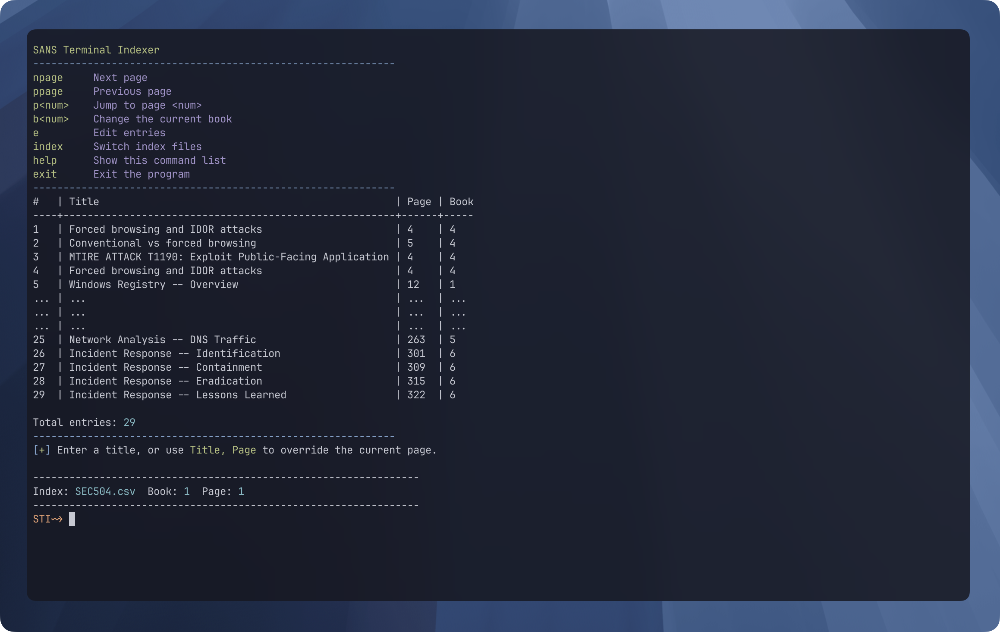

# SANS Index Builder

A lightweight command-line tool for creating and managing SANS course indexes in a CSV format.

> This is a fork of [grahamhelton/SansTerminalIndexer](https://github.com/grahamhelton/SansTerminalIndexer). I've modify it with the help of AI to suit my needs.
>
> "The goal of this project is to create a very fast/efficient way to create an index. This program was greatly inspired by Matthew Toussain's [Voltaire](https://voltaire.publickey.io/) and Lesley Carhart's [Better GIAC testing With Pancakes](https://tisiphone.net/2015/08/18/giac-testing/)"



## Features

* Create and switch between multiple indexes
* Add entries quickly from the terminal
* Track the current page and book
* Preview the first and last entries
* Edit the CSV file using $EDITOR
* Recall recent titles using command history

## Requirements

* Python 3.10 or newer
* A terminal that supports ANSI colours

## Installation

```bash
https://github.com/Al3bad/idxbuilder
cd idxbuild
# Set your prefered terminal editor
export EDITOR=vim
python3 ./index.py

```

## Index Location

Indexes are stored in a hidden .Index directory inside the current working directory.

```
idxbuilder/
├── index.py
└── .Index/
    ├── SEC504.csv
    └── SEC503.csv
```

## Commands

```
Command     Description
-------------------------------------
npage       Move to the next page
ppage       Move to the previous page
p<number>   Change the current page
b<number>   Change the current book
e           Edit the current CSV file
index       Switch to another index
help        Show command help
exit        Save and exit
```

## Editing the Index

1. Use the `e` command:

```
STI~> e<enter>
```

2. The program opens the current CSV file in the editor defined by $EDITOR.

3. Save and exit the editor to return to the indexer.


## Command History

On macOS and Linux, recent titles can usually be recalled using the Up and Down arrow keys.

The program keeps the latest ten titles in the current terminal session.

On systems where Python’s `readline` module is unavailable, the indexer still works, but title history is disabled.
